# Wallpapers

Desktop backgrounds, served as plain image files.

## Installing

```sh
git clone https://github.com/nightdevil00/Wallpapers.git
cd Wallpapers
./install.sh
```

Images go into `~/Pictures/Wallpapers`, which is where
[the wallpaper picker](https://github.com/nightdevil00/Plugins/tree/main/mihai.picker)
looks. Point it elsewhere with `./install.sh --dir ~/some/path`.

The script only copies files that are missing or different, so re-running it
is cheap and it leaves anything you have added yourself alone.

| Option | What it does |
| --- | --- |
| `./install.sh` | copy into `~/Pictures/Wallpapers` |
| `./install.sh --dir PATH` | copy somewhere else |
| `./install.sh --list` | show what's available, copy nothing |
| `./install.sh --force` | overwrite existing files |

Set one with `swww img set ~/Pictures/Wallpapers/<file>`.

## The 18 images

<table>
  <tr>
    <td width="33%">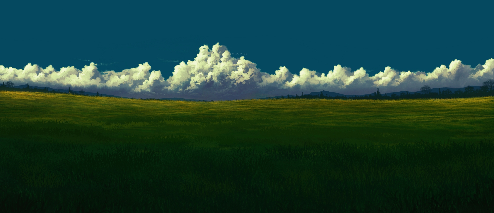<br><sub><code>122252287_p0.jpg</code></sub></td>
    <td width="33%">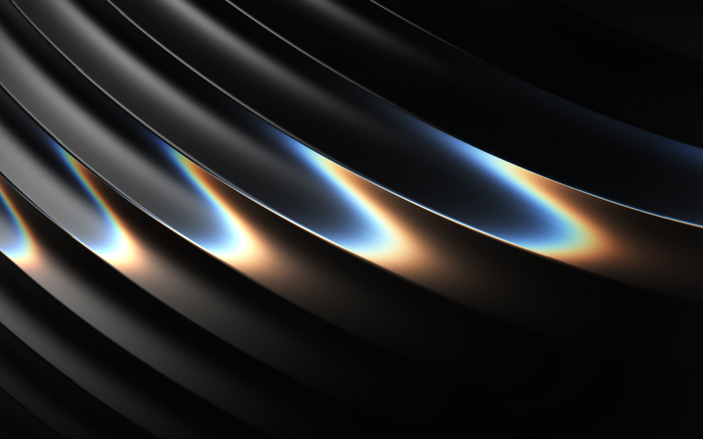<br><sub><code>G5uBmitWkAAyk8s.jpg</code></sub></td>
    <td width="33%">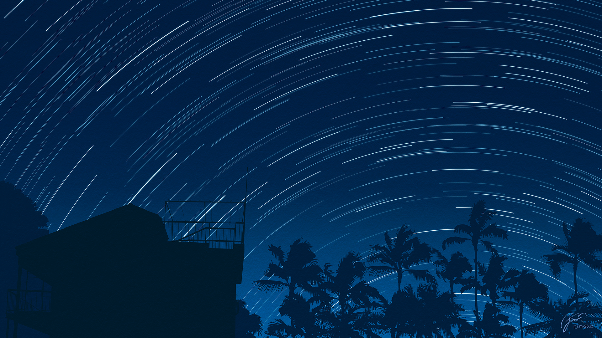<br><sub><code>a_building_with_trees_and_stars_in_the_sky.jpg</code></sub></td>
  </tr>
  <tr>
    <td width="33%">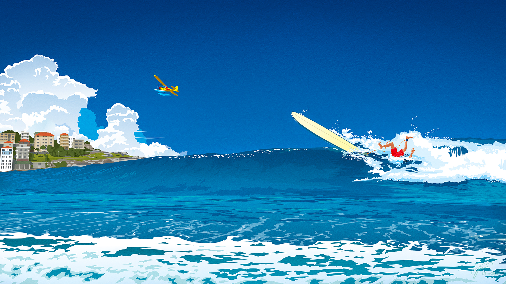<br><sub><code>a_couple_of_planes_flying_over_a_wave.jpg</code></sub></td>
    <td width="33%">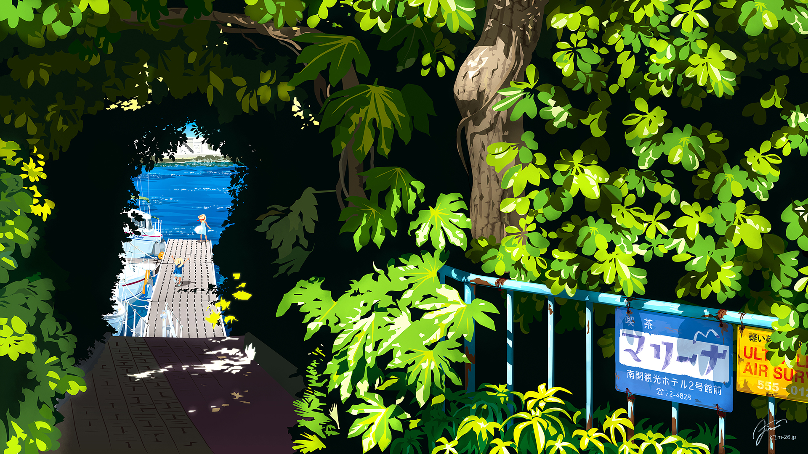<br><sub><code>a_dock_with_trees_and_a_blue_railing.jpg</code></sub></td>
    <td width="33%">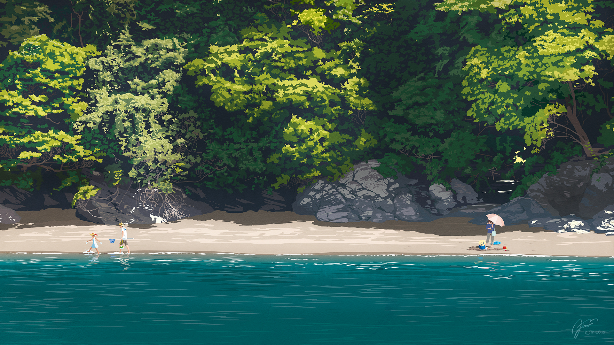<br><sub><code>a_person_on_a_beach.jpg</code></sub></td>
  </tr>
  <tr>
    <td width="33%">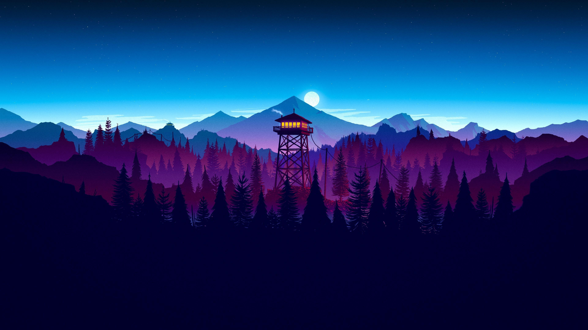<br><sub><code>camp_in_blue.jpg</code></sub></td>
    <td width="33%">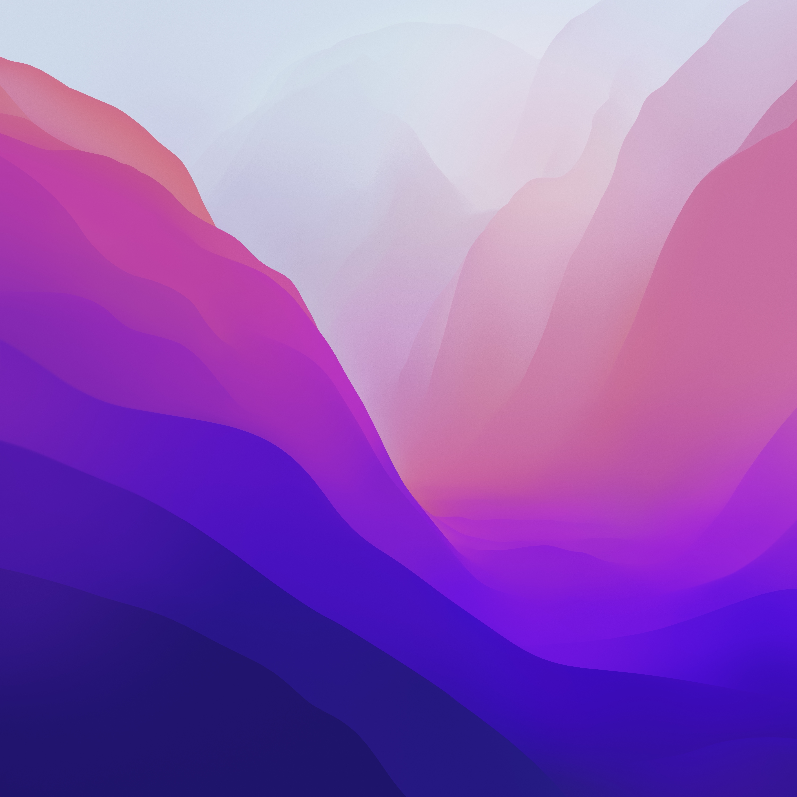<br><sub><code>macos-monterey-wwdc-21-stock-5k-6016x6016-5584.jpg</code></sub></td>
    <td width="33%"><br><sub><code>macos-sequoia-4096x2262-17019.jpg</code></sub></td>
  </tr>
  <tr>
    <td width="33%"><br><sub><code>macos-sequoia-4096x2264-17018.jpg</code></sub></td>
    <td width="33%">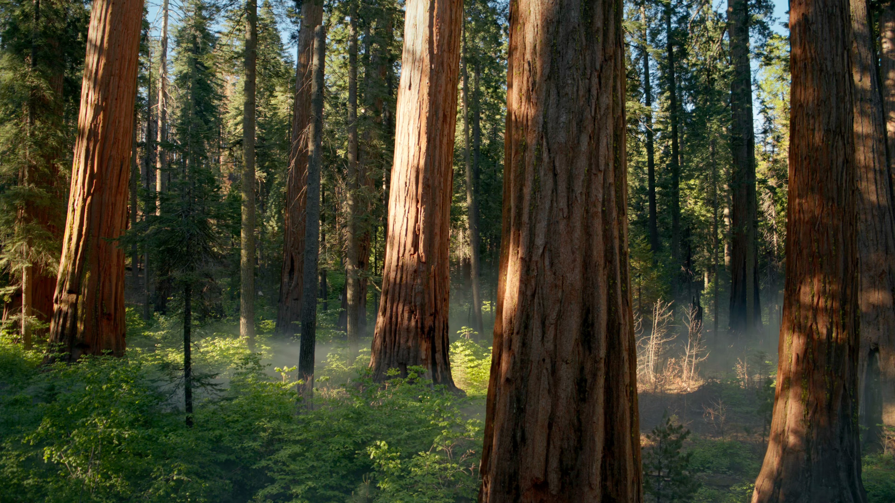<br><sub><code>macos-sequoia-forest-3840x2160-24082.jpg</code></sub></td>
    <td width="33%">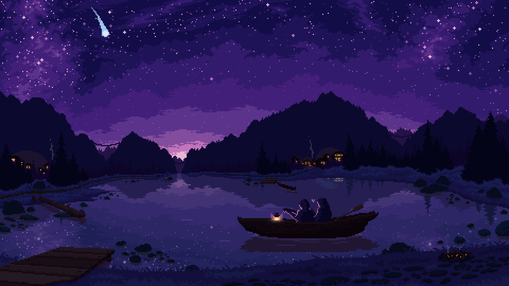<br><sub><code>qs-niri.jpg</code></sub></td>
  </tr>
  <tr>
    <td width="33%"><br><sub><code>sakura-1.jpg</code></sub></td>
    <td width="33%">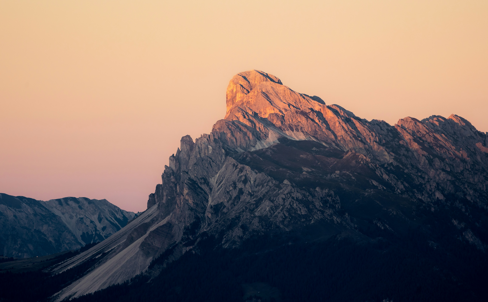<br><sub><code>wallhaven-211xrg.jpg</code></sub></td>
    <td width="33%">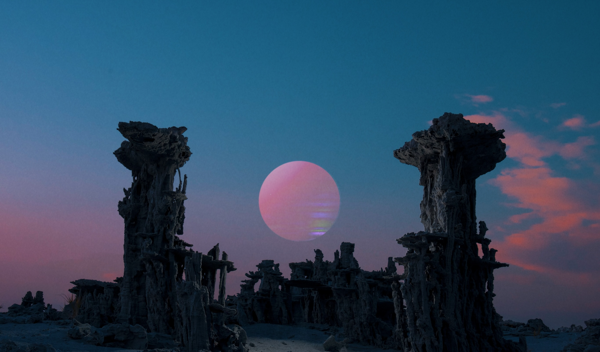<br><sub><code>wallhaven-5yzd98.png</code></sub></td>
  </tr>
  <tr>
    <td width="33%">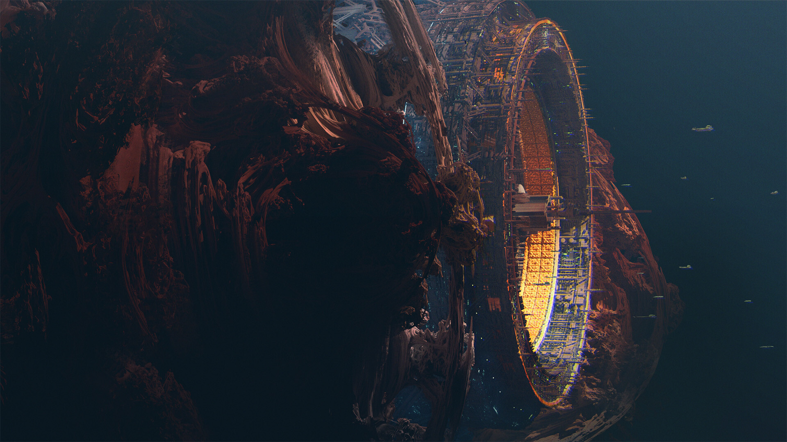<br><sub><code>wallhaven-ex.png</code></sub></td>
    <td width="33%"><br><sub><code>wallhaven-jeej1q.jpg</code></sub></td>
    <td width="33%">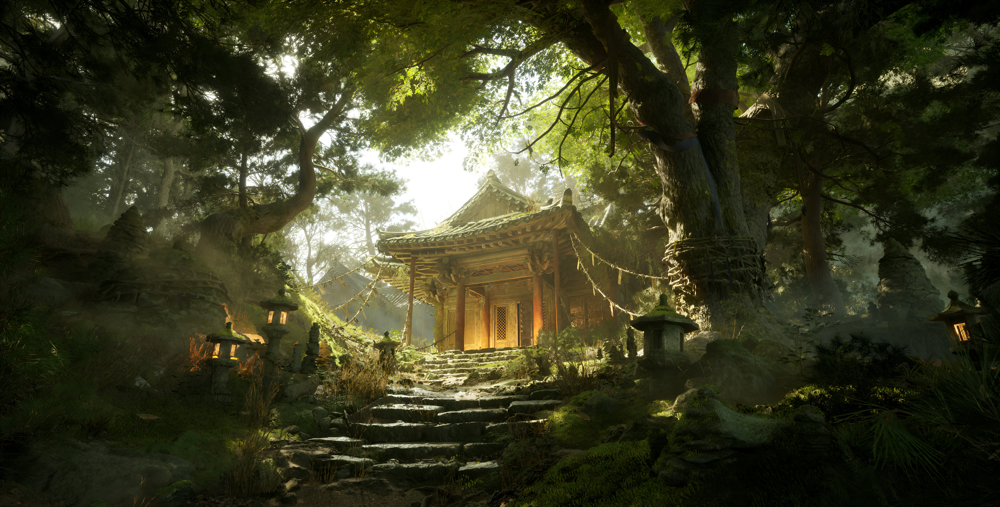<br><sub><code>wallhaven-jeew7y.jpg</code></sub></td>
  </tr>
</table>

## Layout

```
Wallpapers/
  122252287_p0.jpg
  a_building_with_trees_and_stars_in_the_sky.jpg
  ...
```

Kept flat, with descriptive filenames where the original had a usable name.
